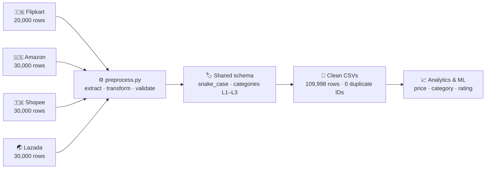

<div align="center">

# 🛒 Supply Chain Big Data Analytics

### Multi-platform e-commerce product data: collected, cleaned and unified

*~110,000 product records from Amazon, Flipkart, Shopee and Lazada, turned into one consistent, analysis-ready schema.*


[**Datasets**](#-datasets) · [**Pipeline**](#-cleaning-pipeline) · [**Data quality**](#-data-quality) · [**Run it**](#-run-it) · [**Next steps**](#-next-steps)

</div>

---

## 📌 Overview

Product data from different marketplaces looks nothing alike: different column names, currencies, category formats,
HTML in descriptions, placeholder brands and duplicate IDs. This project builds a **reproducible ETL pipeline** that
takes four raw marketplace datasets and produces clean CSVs with a **shared schema**, ready for analytics and
machine learning.

> Team project (5 members) for the **Big Data Analytics** course, INTI International University Mobility Programme.
> Full details are in [`SupplyChain_Dataset_Summary.pdf`](SupplyChain_Dataset_Summary.pdf).

## 📦 Datasets

| Platform | Region | Raw (rows × cols) | Clean (rows × cols) | Currency | Source |
|---|---|---:|---:|:-:|---|
| 🇮🇳 **Flipkart** | India | 20,000 × 15 | 19,998 × 20 | INR | [PromptCloudHQ Flipkart Products](https://huggingface.co/datasets/jason1966/PromptCloudHQ_flipkart-products) |
| 🇺🇸 **Amazon** | Global | 30,000 × 14 | 30,000 × 20 | USD | [AMAZON-Products-2023](https://huggingface.co/datasets/milistu/AMAZON-Products-2023) (random 30K sample, seed 42) |
| 🇹🇼 **Shopee** | Taiwan | 30,000 × 52 | 30,000 × 45 | TWD | [Rebrowser Shopee dataset](https://huggingface.co/datasets/rebrowser/shopee-dataset) |
| 🌏 **Lazada** | Southeast Asia | 30,000 × 11 | 30,000 × 15 | not stated | [Shopping Companion](https://huggingface.co/datasets/yuzhan2205/Shopping-companion) (30K extract) |
| | | **110,000** | **109,998** | | |

## 🔧 Cleaning pipeline



```
raw/<platform>/<name>_raw.csv  ──►  scripts/preprocess.py  ──►  preprocessed/<platform>/<name>_clean.csv
```

**Applied to all four datasets**

- 🏷️ **Shared schema** — snake_case columns with common names across platforms: `platform`, `product_id`,
  `product_name`, `brand`, `category_path`, `category_l1`–`category_l3`, `rating`, `description`
- 🧹 **Text cleaning** — HTML tags stripped, whitespace and line breaks collapsed, empty strings → missing
- 🗂️ **Categories** — split into a full path plus the first three levels
- 🚫 **Placeholder brands** — "No Brand", "OEM", "Generic", "nobrand" etc. set to missing
- 🔁 **Deduplication** — duplicate product IDs removed
- 🤚 **No imputation** — missing values are left empty so later analysis can decide how to treat them

**Platform-specific fixes**

| Platform | Fixes |
|---|---|
| Flipkart | Parsed category trees; Ruby-hash specs → valid JSON; merged duplicate rating columns; added `discount_pct`, image URL/count; UTC timestamps |
| Amazon | Brand from `store` (removing "Format: …" suffixes); feature bullets joined with a count; Python-dict details → JSON; zero prices → missing |
| Shopee | Dropped 9 unusable columns (redacted or empty); prices ÷ 100,000 to real TWD; rating 0 with no reviews → missing; category JSON → names |
| Lazada | Brand extracted from the attributes JSON; redundant columns removed; option count added |

## ✅ Data quality

Every cleaned file was re-read and checked: **no duplicate product IDs** and **one CSV line per record**.

| Platform | Main remaining gaps |
|---|---|
| Flipkart | rating 91%, brand 29% missing |
| Amazon | price 31%, main category 21%, brand 7% missing |
| Shopee | shipping fee 85%, rating 68%, brand 59% missing |
| Lazada | brand 68%, options 45%, description 39% missing |

## 🚀 Run it

```bash
python -m venv .venv
.venv/bin/pip install pandas
# place the raw CSVs in raw/<platform>/ (see the sources above)
.venv/bin/python scripts/preprocess.py
```

> Raw and cleaned CSVs (~180 MB) are not committed to keep the repo light. Download them from the sources above.

## 📁 Project structure

```
SupplyChain-BigDataAnalytics/
├── scripts/
│   └── preprocess.py                  # full ETL for all four platforms
├── raw/                               # source CSVs (not committed)
├── preprocessed/                      # cleaned CSVs (generated)
├── SupplyChain_Dataset_Summary.pdf    # detailed dataset & cleaning report
└── README.md
```

## 🔭 Next steps

- **Price prediction** (regression) from category, brand, text and seller features
- **Category classification** from product name and description
- **Rating / popularity prediction** — strongest on Shopee and Amazon
- **Discount analysis and seller clustering** — Flipkart and Shopee have discount fields

> Prices are in different currencies, so they must be converted or modelled per platform. Shopee text is in Chinese.

## 👥 Team

Built by a team of five as part of the INTI International University Mobility Programme.
Maintained by [Mohammad Yasin Siddique](https://github.com/MYSiddique2005).
